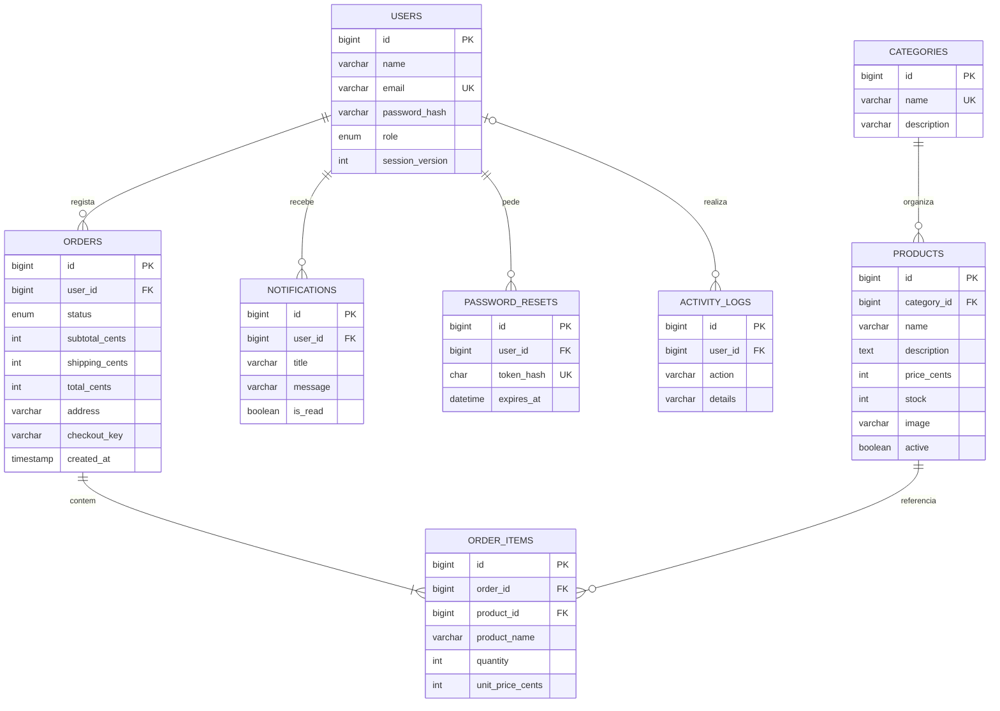
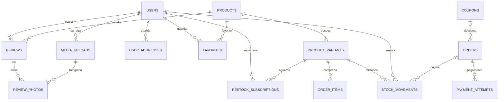

# Modelo de dados

O instalador cria a base `forma_shop`, executa `database/schema.sql` e aplica `database/commerce.sql` através de `server/migrate.php`. As tabelas de negócio usam InnoDB e `utf8mb4`, com chaves estrangeiras nas relações principais. Os montantes são inteiros em cêntimos para evitar erros de arredondamento.

O módulo editorial aplica também `database/news.sql`, através de `server/news-migration.php`:

- `news_categories`: ID e nome único. São independentes das categorias de produtos.
- `news_articles`: categoria obrigatória, autor (utilizador), título, conteúdo, data da notícia, caminho da imagem opcional e datas de criação/alteração. A ordenação usa a data editorial e o ID, ambos em ordem decrescente.
- A categoria tem uma chave estrangeira com eliminação restrita. O autor usa `ON DELETE SET NULL`, preservando a notícia se a conta for removida. Eliminar uma notícia remove o registo, mantendo a operação no histórico `activity_logs`.
- A migração `news-v1`, guardada em `schema_migrations`, insere três notícias de exemplo uma única vez. Reinstalar preserva edições e eliminações posteriores.

`rate_limits` é uma tabela auxiliar para contagem de tentativas por operação e endereço IP, com expiração. Não guarda o endereço IP em claro.

## Extensão de comércio

| Tabela | Conteúdo e regras |
| --- | --- |
| `product_variants` | SKU único, nome da opção, cor, tamanho, material, imagem, preço, stock e estado ativo |
| `user_addresses` | Até 10 moradas por conta; uma principal, validada em transação |
| `coupons` | Código único, tipo/valor, mínimo, validade, máximo e contador de utilizações |
| `favorites` | Relação única utilizador/produto; até 200 por conta |
| `restock_subscriptions` | Relação única utilizador/variante, removida após notificação de reposição |
| `stock_movements` | Variação de quantidade, saldo, motivo, responsável e encomenda opcional |
| `payment_attempts` | Resultado, valor, UUID idempotente por encomenda e data; apenas simulação |
| `reviews` | Uma por utilizador/produto, classificação, comentário e visibilidade de moderação |
| `media_uploads` | Proprietário, caminho aleatório e finalidade da imagem |
| `review_photos` | Fotografias associadas à avaliação; máximo 3 validado no servidor |
| `schema_migrations` | Versões de migração aplicadas |

`orders` acrescenta desconto, cupão, método de entrega e estado de pagamento. `order_items` acrescenta a variante e o nome da opção no momento da compra. O stock de `products` é a soma das variantes ativas; o preço é o menor preço dessas opções.

Os campos acrescentados `orders.coupon_id` e `order_items.variant_id` são referências validadas pela aplicação, sem uma nova restrição de chave estrangeira nesta migração. Cupões são desativados e variantes arquivadas, preservando os registos usados por encomendas antigas.

A migração `commerce-v1` cria uma variante padrão por produto existente, associa linhas antigas e regista inventário inicial. Os valores das encomendas antigas são preservados; o estado de pagamento é inicializado como aprovado de demonstração. Executar novamente o instalador não duplica variantes nem movimentos iniciais.

As linhas de encomenda guardam um retrato do nome, preço e imagem do produto no momento da compra. A alteração posterior de um produto não modifica encomendas antigas. Existe uma restrição única em `(user_id, checkout_key)` para impedir pedidos duplicados.

As operações de stock e movimentos são feitas na mesma transação que a encomenda. Os produtos e variantes são bloqueados por ordem crescente de ID. O cupão é bloqueado antes de consumir uma utilização. A aplicação faz rollback se qualquer artigo ou cupão estiver indisponível. O cancelamento bloqueia a encomenda antes de repor stock e utilização do cupão, impedindo reposições repetidas. Pagamentos pendentes ou recusados mantêm a reserva até pagamento ou cancelamento explícito.

Para consultar os dados no phpMyAdmin, inicia Apache e MySQL no XAMPP e abre `http://localhost/phpmyadmin/`. A importação manual do esquema não cria o administrador nem o catálogo; `server/install.php` trata desses passos.

## Migração experience-v1

`database/experience.sql` e `server/experience-migration.php` acrescentam:

| Tabela | Relação e finalidade |
| --- | --- |
| `news_revisions` | Retrato JSON de uma versão, notícia e editor; elimina em cascata com a notícia |
| `favorite_shares` | Uma partilha por utilizador, hash único do token |
| `support_tickets`, `support_messages` | Pedido do cliente, estado e conversa com autores |
| `return_requests` | Pedido único por encomenda, proprietário, motivo, decisão e nota administrativa |
| `bundles`, `bundle_items` | Conjunto e pares únicos conjunto/variante com quantidade |
| `ai_jobs` | Pedido privado, finalidade, estado, dados de entrada/resultado e timestamps; limpeza após 24 horas |
| `mail_outbox` | Fila de envio, destinatário, assunto, corpo temporário, estado e tentativas |

As notícias recebem `status`, `publish_at` e `version`; produtos recebem `dimensions`, inicialmente extraídas da descrição. São guardadas versões iniciais das notícias existentes e três conjuntos baseados em produtos reais. A marca de migração impede duplicação ou recriação de exemplos eliminados. As credenciais externas não são guardadas nestas tabelas: ficam no ficheiro privado `storage/integrations.json`.

## Migração improvements-v1

`email_changes` guarda um pedido pendente por utilizador, email anterior/novo, hash do token, versão da sessão e validade. `product_images` associa fotografias ordenadas ao produto e opcionalmente a uma variante. `order_events` guarda estados e datas, permitindo data nula apenas para estados anteriores sem data conhecida. `support_attachments` liga ficheiros privados ao autor e à mensagem, com MIME/tamanho. `backups` regista autor, data, tamanho e SHA-256 do arquivo privado.

A migração preserva o catálogo e as contas. O histórico inicial das encomendas é criado uma única vez. Não se inventam datas de preparação ou envio para encomendas antigas.

## Identidades Google

`google_identities` associa um `user_id` único ao `subject` (`sub`) único, ASCII e sensível a maiúsculas, do Google. A eliminação do utilizador remove a associação. Tokens e Client Secret não são guardados nesta tabela. Novas contas Google recebem sempre o papel `customer`. Contas existentes exigem associação explícita a partir de uma sessão autenticada.
